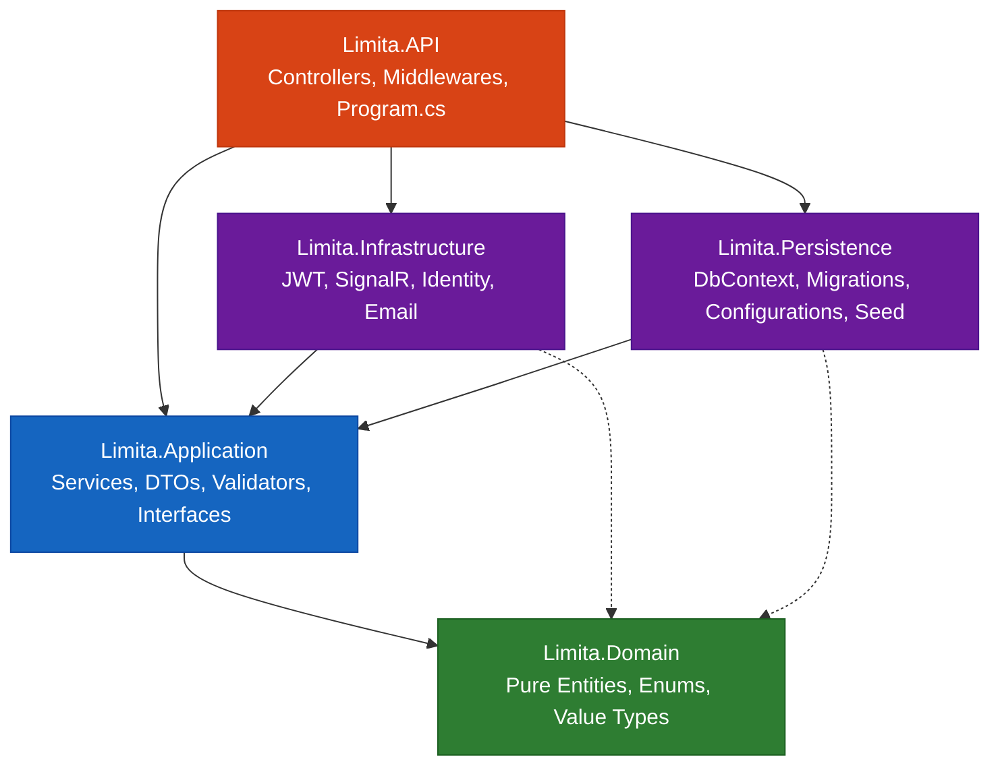
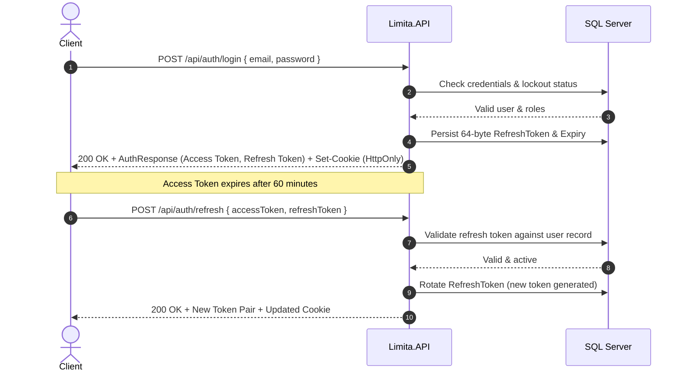

# Limita — Digital Banking & Multi-Currency REST API

[](https://dotnet.microsoft.com/)
[](https://docs.microsoft.com/dotnet/csharp/)
[](https://docs.microsoft.com/ef/core/)
[](https://www.microsoft.com/sql-server/)
[](https://www.docker.com/)
[](#-solution-architecture)
[](#-testing--verification)

**Limita** is a high-performance, production-grade Digital Banking REST API built on **.NET 9 (net9.0)** and **C# 13**, conforming to the principles of **Lean Clean Architecture**. Designed to mirror modern retail and commercial banking engines, Limita provides core capabilities including multi-currency account management, dynamic tiered limit enforcement, two-phase atomic peer-to-peer transfers with ledger double-entry bookkeeping, card lifecycle issuance and PIN management, real-time foreign exchange quoting and conversions, utility bill aggregations, and mobile operator balance recharges.

---

## 📑 Table of Contents

1. [Project Overview & Business Domain](#-project-overview--business-domain)
2. [Solution Architecture & Design Patterns](#-solution-architecture--design-patterns)
3. [Local Environment Setup & Execution](#-local-environment-setup--execution)
4. [Database, Migrations & Seeding](#-database-migrations--seeding)
5. [Authentication, Authorization & Security](#-authentication-authorization--security)
6. [Complete REST API Reference](#-complete-rest-api-reference)
   - [Authentication & Password Lifecycle](#1-authentication--password-lifecycle)
   - [User Profile Management](#2-user-profile-management)
   - [Accounts & Limits Management](#3-accounts--limits-management)
   - [Card Issuance & Controls](#4-card-issuance--controls)
   - [Transfers & Two-Phase Execution](#5-transfers--two-phase-execution)
   - [Transactions & Financial Summaries](#6-transactions--financial-summaries)
   - [Transfer Beneficiaries](#7-transfer-beneficiaries)
   - [Foreign Currency Exchange](#8-foreign-currency-exchange)
   - [Utility Bills & Payments](#9-utility-bills--payments)
   - [Mobile Recharge & Cash Operations](#10-mobile-recharge--cash-operations)
   - [Push Notifications & SignalR Hub](#11-push-notifications--signalr-hub)
   - [Health & Diagnostics](#12-health--diagnostics)
7. [Testing & Verification](#-testing--verification)

---

## 🏛 Project Overview & Business Domain

Limita operates as a full-featured digital banking back-end providing financial services with strict regulatory and concurrency compliance:

* **Multi-Currency Account Vaults**: Open and manage primary checking and secondary savings accounts in Egyptian Pounds (`EGP`), US Dollars (`USD`), and Euros (`EUR`).
* **Velocity & Tiered Account Limits**: Real-time enforcement and customization of per-transaction ceilings, 24-hour daily rolling velocity limits, and 30-day monthly cumulative debit limits.
* **Two-Phase Atomic Transfers**: Resilient inter-account transfers executed via a draft initiation (`Pending`) phase and an atomic execution (`Confirm`) phase under SQL Server isolation transactions and EF Core `ExecutionStrategy`.
* **Card Lifecycle & Security**: Issuance of physical and virtual Debit/Credit cards, cryptographic PBKDF2 ATM PIN hashing, custom daily ATM/POS spending limits, and immediate temporary or permanent locking.
* **Foreign Currency Exchange**: Server-calculated FX quotes and atomic multi-currency balance transfers at institutional conversion rates.
* **Utility Bill Payment Aggregator**: Bill retrieval and instant settlement across public and private utility providers (telecom, electricity, water, internet).
* **Mobile Operator Airtime Recharge**: Direct airtime balance replenishment supporting all major Egyptian telecom operators (Vodafone, Orange, Etisalat, WE).
* **Real-Time Push Notifications**: In-app notifications backed by persistent database storage and instant live delivery using ASP.NET Core SignalR.

### Core Technology Stack

| Layer / Concern | Technology | Role |
| :--- | :--- | :--- |
| **Runtime Framework** | .NET 9.0 SDK (`net9.0`) | Modern runtime leveraging C# 13 language capabilities |
| **Web API Engine** | ASP.NET Core Web API | Controller-based RESTful API with routing, rate limiting, and content negotiation |
| **Object-Relational Mapping** | Entity Framework Core 9 | Code-First migrations, split queries, optimistic concurrency, and retry execution strategies |
| **Database Engine** | Microsoft SQL Server 2022 | Relational persistence, RowVersion concurrency tokens, unique indexes, and referential constraints |
| **Identity & Access Management** | ASP.NET Core Identity + JWT | Argon2/PBKDF2 credential management, HMAC-SHA256 access tokens, 64-byte refresh tokens |
| **Real-Time Messaging** | ASP.NET Core SignalR | WebSocket, Server-Sent Events, and Long Polling hub (`/hubs/notifications`) |
| **Input Validation** | FluentValidation 11 | Assembly-scanned declarative validation pipeline |
| **Rate Limiting** | `Microsoft.AspNetCore.RateLimiting` | Built-in Fixed Window rate limiter (`AuthLimiter`, 10 req/min) for attack mitigation |
| **Containerization** | Docker & Docker Compose | Multi-stage production container build with health checks and SQL Server orchestrator |
| **API Documentation** | OpenAPI 3.0 / Swagger UI | Interactive documentation with integrated Bearer scheme authorization |

---

## 🏗 Solution Architecture & Design Patterns

The solution strictly adheres to **Lean Clean Architecture** (Domain-Centric design). Outward layers depend inwards toward abstractions; the core Domain remains pure and contains **zero third-party NuGet dependencies**.

```text
Limita.sln
├── src/
│   ├── Limita.Domain/              # Core Domain: Entities, Enums, BaseEntity (Zero External Dependencies)
│   ├── Limita.Application/         # Application: Interfaces, DTOs, FluentValidators, Feature Services
│   ├── Limita.Persistence/         # Persistence: EF Core 9, LimitaDbContext, Configurations, Migrations, Seed
│   ├── Limita.Infrastructure/      # Infrastructure: JWT Generator, Identity, SignalR Hubs, Email, PIN Hasher
│   └── Limita.API/                 # Presentation: Controllers, Middlewares, DI Setup, Swagger, Program.cs
└── tests/
    ├── Limita.Application.Tests/   # Unit & Service Tests: Feature unit tests, mocking, validator assertions
    └── Limita.IntegrationTests/    # End-to-End Integration Tests: WebApplicationFactory with isolated SQL DB
```



### Dependency Rules & Layer Responsibilities

1. **`Limita.Domain`**: Pure C# class library containing no references to external libraries or other projects in the solution. Defines core domain models (`Account`, `ApplicationUser`, `BankCard`, `Beneficiary`, `Bill`, `BillProvider`, `ExchangeRate`, `MobileRecharge`, `Notification`, `PasswordResetOtp`, `Transaction`, `Transfer`, `Withdrawal`), business enums, and `BaseEntity` providing `Guid` primary keys and UTC audit timestamps.
2. **`Limita.Application`**: Encapsulates business logic organized into vertical feature slices (`Accounts`, `Auth`, `Beneficiaries`, `Bills`, `Cards`, `Exchange`, `Limits`, `Notifications`, `Recharge`, `Transactions`, `Transfers`, `Users`). Declares database and service abstractions (`IApplicationDbContext`, `ICurrentUserService`, `IJwtTokenGenerator`, `ILimitService`, `INotificationService`), DTO contracts, and FluentValidation rules.
3. **`Limita.Persistence`**: Implements data access using Entity Framework Core 9 and SQL Server. Contains `LimitaDbContext` inheriting from `IdentityDbContext<ApplicationUser>`, explicit Fluent API configurations with decimal precision (`18, 2` for currency; `18, 6` for FX rates), optimistic concurrency `RowVersion` properties, code-first migrations, and idempotent database seeder (`DbInitializer`).
4. **`Limita.Infrastructure`**: Implements system infrastructure: HMAC-SHA256 cryptographic JWT generation (`JwtTokenGenerator`), `CurrentUserService` parsing claims from `IHttpContextAccessor`, SignalR real-time notification push (`NotificationHub`, `CustomUserIdProvider`), PBKDF2 card PIN hashing (`CardPinHasher`), and transactional email delivery (`EmailService`).
5. **`Limita.API`**: ASP.NET Core presentation layer. Configures dependency injection extensions, ASP.NET Core rate limiting, JWT Bearer authentication and authorization policies, Swagger UI documentation, global exception translation, and HTTP middleware pipeline orchestration.

### Key Architectural Patterns

#### 1. Atomic Two-Phase Transfer Workflow
Inter-account transfers are decoupled into a two-phase process to guarantee financial consistency and prevent duplicate charges:
* **Phase 1: Initiation (`POST /api/transfers`)**: Validates source account ownership, active statuses, currency equivalence, funds availability, and debit limit rules. Creates an immutable `Transfer` record in `Pending` status and registers a pending ledger transaction.
* **Phase 2: Confirmation (`POST /api/transfers/{id}/confirm`)**: Executes atomically inside a dedicated database transaction. Uses EF Core `IExecutionStrategy` for connection resilience. In a single atomic step:
  * Re-verifies source balance and limits to avoid race conditions.
  * Debits the sender account and credits the recipient account.
  * Updates the ledger with double-entry records (`TransferOut` and `TransferIn`).
  * Transitions the transfer status to `Completed`.
  * Triggers real-time SignalR push notifications and email receipts to both parties.
* **Phase 2 Alternate: Cancellation (`POST /api/transfers/{id}/cancel`)**: Allows the initiator to safely abort a pending transfer prior to execution.

#### 2. Optimistic Concurrency Control
The `Account` domain entity features a timestamp concurrency token (`public byte[] RowVersion { get; set; } = [];`) mapped to SQL Server's native `rowversion` type. Any concurrent debit, credit, or limit modification colliding with another in-flight transaction triggers a `DbUpdateConcurrencyException`, protecting account balances against lost updates.

#### 3. Standardized API Envelope (`ApiResponse<T>`)
All endpoints return a uniform response envelope across successful operations and controlled business errors:
```json
{
  "success": true,
  "message": "Operation completed successfully.",
  "data": { ... },
  "errors": null,
  "timestamp": "2026-10-14T03:00:00Z"
}
```

#### 4. Global Exception Translation Middleware
Uncaught application exceptions are intercepted by `ExceptionHandlingMiddleware`, sanitized, and translated into standardized HTTP status codes and `ApiResponse` envelopes:
* `KeyNotFoundException` $\rightarrow$ `404 Not Found`
* `FluentValidation.ValidationException` $\rightarrow$ `400 Bad Request` with detailed validation error messages
* `ArgumentException` / `InvalidOperationException` $\rightarrow$ `400 Bad Request`
* `UnauthorizedAccessException` $\rightarrow$ `403 Forbidden`
* Unhandled Server Errors $\rightarrow$ `500 Internal Server Error` (stack traces masked in Production)

---

## 🚀 Local Environment Setup & Execution

### Prerequisites

* [.NET 9.0 SDK](https://dotnet.microsoft.com/download/dotnet/9.0) (Version 9.0.100 or newer)
* [Docker Desktop](https://www.docker.com/products/docker-desktop/) **OR** a local instance of [Microsoft SQL Server 2022](https://www.microsoft.com/sql-server/sql-server-downloads) / SQL Express / LocalDB
* [Git](https://git-scm.com/)

---

### Option A: Running with Docker Compose (Recommended)

Docker Compose provisions both the Microsoft SQL Server 2022 container and the Limita REST API container with health check dependencies and automatic migrations.

1. **Clone the repository**:
   ```bash
   git clone https://github.com/TopKing74/Limita.git
   cd Limita
   ```

2. **Start the containers**:
   ```bash
   docker compose up --build -d
   ```

3. **Verify running containers**:
   ```bash
   docker compose ps
   ```

   | Service | Container Name | Host Port | Internal Port | Status |
   | :--- | :--- | :--- | :--- | :--- |
   | **Database** | `limita-db` | `1433` | `1433` | Healthy (`sqlcmd SELECT 1`) |
   | **REST API** | `limita-api` | `5211` | `8080` | Healthy (`curl /health`) |

4. **Access the API Documentation**:
   Open [http://localhost:5211](http://localhost:5211) in your browser to interact with the Swagger UI.

5. **Stop containers and tear down resources**:
   ```bash
   docker compose down -v
   ```

---

### Option B: Running Locally via .NET CLI

1. **Clone the repository**:
   ```bash
   git clone https://github.com/TopKing74/Limita.git
   cd Limita
   ```

2. **Restore NuGet dependencies**:
   ```bash
   dotnet restore Limita.sln
   ```

3. **Configure Database Connection**:
   Ensure your local SQL Server instance is running. Review the connection string in `src/Limita.API/appsettings.json`:
   ```json
   "ConnectionStrings": {
     "DefaultConnection": "Server=.;Database=LimitaDb;Trusted_Connection=True;MultipleActiveResultSets=true;TrustServerCertificate=True"
   }
   ```
   *(For SQL Server Express, update the server name to `Server=.\\SQLEXPRESS;...`)*

4. **Apply EF Core Migrations**:
   ```bash
   dotnet ef database update --project src/Limita.Persistence --startup-project src/Limita.API
   ```

5. **Launch the API**:
   ```bash
   dotnet run --project src/Limita.API
   ```

6. **Interactive Documentation**:
   Navigate to [http://localhost:5211](http://localhost:5211) or [https://localhost:7027](https://localhost:7027). The application root redirects to Swagger UI.

---

### Environment Configuration Reference

The following keys can be customized via `src/Limita.API/appsettings.json` or overriden via environment variables (e.g. in containerized or CI/CD deployments):

| Configuration Key | Environment Variable Equivalent | Default Value | Description |
| :--- | :--- | :--- | :--- |
| `ConnectionStrings:DefaultConnection` | `ConnectionStrings__DefaultConnection` | `Server=.;Database=LimitaDb;...` | ADO.NET connection string to Microsoft SQL Server |
| `JwtSettings:Issuer` | `JwtSettings__Issuer` | `LimitaBankingServer` | Token issuer claim verified during JWT validation |
| `JwtSettings:Audience` | `JwtSettings__Audience` | `LimitaBankingClient` | Token audience claim verified during JWT validation |
| `JwtSettings:SecretKey` | `JwtSettings__SecretKey` | *(32+ character secret)* | Symmetric secret key used for HMAC-SHA256 signature |
| `JwtSettings:ExpiryMinutes` | `JwtSettings__ExpiryMinutes` | `60` | Lifespan in minutes for issued access tokens |
| `JwtSettings:RefreshTokenExpiryDays` | `JwtSettings__RefreshTokenExpiryDays` | `7` | Lifespan in days for cryptographic refresh tokens |
| `EmailSettings:SmtpServer` | `EmailSettings__SmtpServer` | `smtp.gmail.com` | SMTP host used for password reset & OTP emails |
| `EmailSettings:Port` | `EmailSettings__Port` | `587` | SMTP port (TLS/STARTTLS) |
| `EmailSettings:SenderName` | `EmailSettings__SenderName` | `Limita Bank` | Display name on outgoing financial notifications |
| `EmailSettings:SenderEmail` | `EmailSettings__SenderEmail` | *(configured email)* | Sender email address for outgoing system emails |
| `EmailSettings:Password` | `EmailSettings__Password` | *(configured app password)* | Authentication credential or App Password for SMTP |

---

## 🗄 Database, Migrations & Seeding

### Managing EF Core Migrations

Limita uses Entity Framework Core 9 Code-First migrations located in `src/Limita.Persistence/Migrations`. Use the .NET EF global tool to manage migrations:

```bash
# Apply all pending migrations to the configured database
dotnet ef database update --project src/Limita.Persistence --startup-project src/Limita.API

# Add a new migration after domain model updates
dotnet ef migrations add <MigrationName> --project src/Limita.Persistence --startup-project src/Limita.API

# Revert the most recently added migration (if unapplied)
dotnet ef migrations remove --project src/Limita.Persistence --startup-project src/Limita.API

# Generate an idempotent SQL script for Production deployment
dotnet ef migrations script --idempotent --project src/Limita.Persistence --startup-project src/Limita.API -o migrate.sql
```

> [!NOTE]
> When running the application locally via `dotnet run` or Docker, `Program.cs` automatically invokes `context.Database.MigrateAsync()` and `DbInitializer.SeedAsync(services)` during service startup.

---

### Out-of-the-Box Seed Data (`DbInitializer`)

Upon first run, `DbInitializer` idempotently seeds roles, users, financial accounts, exchange rates, cards, and utility bills.

#### 1. Identity Roles & Demo Credentials
| Role | Email | Password | Phone Number | Description |
| :--- | :--- | :--- | :--- | :--- |
| **Admin** | `admin@limita.bank` | `Admin@123456!` | `+201000000001` | System Administrator with elevated privileges |
| **Customer** | `john.doe@limita.bank` | `User@123456!` | `+201000000002` | Standard demo customer with pre-configured accounts & cards |

#### 2. Demo User Bank Accounts
| Currency | Type | Account Number | Starting Balance | Daily Limit | Monthly Limit |
| :--- | :--- | :--- | :--- | :--- | :--- |
| **EGP** | Checking | `EG10002000300040` | **100,000.00 EGP** | 50,000.00 EGP | 250,000.00 EGP |
| **USD** | Savings | `US10002000300099` | **$5,000.00 USD** | $2,000.00 USD | $10,000.00 USD |
| **EUR** | Savings | `EU10002000300077` | **€3,000.00 EUR** | €2,000.00 EUR | €10,000.00 EUR |

#### 3. Linked Bank Cards
| Type | Form | Masked Number | Expiry | Default | Daily ATM Limit | Daily POS Limit |
| :--- | :--- | :--- | :--- | :--- | :--- | :--- |
| **Debit** | Physical | `4000 **** **** 1234` | 12 / (Year + 3) | **Yes** | 5,000.00 EGP | 20,000.00 EGP |
| **Credit** | Virtual | `5100 **** **** 5678` | 06 / (Year + 2) | No | 10,000.00 EGP | 50,000.00 EGP |

#### 4. Foreign Exchange (FX) Matrix
| Base Currency | Target Currency | Exchange Rate |
| :--- | :--- | :--- |
| **USD** | **EGP** | `48.500000` |
| **EGP** | **USD** | `0.020619` |
| **EUR** | **EGP** | `52.800000` |
| **EGP** | **EUR** | `0.018939` |
| **USD** | **EUR** | `0.918561` |
| **EUR** | **USD** | `1.088660` |

#### 5. Seeded Bill Providers & Demo Bills
| Provider Name | Category | Billing Number | Amount Due | Due Date | Status |
| :--- | :--- | :--- | :--- | :--- | :--- |
| South Cairo Electricity Distribution | Electricity | `ELEC-2026-98124` | 850.50 EGP | In 14 Days | `Pending` |
| WE Internet Egypt | Internet | `INT-2026-55412` | 320.00 EGP | In 7 Days | `Pending` |
| Cairo Water Company | Water | `WTR-2026-11234` | 145.75 EGP | In 21 Days | `Pending` |
| Orange Telecom Egypt | Telecom | — | — | — | Active Provider |

---

## 🔐 Authentication, Authorization & Security

### JWT Authentication Flow

Limita employs a dual-token authentication pattern combining stateless, short-lived **Access Tokens** with stateful, long-lived **Refresh Tokens**.



1. **Access Token**:
   * Signed using HMAC-SHA256 (`HS256`).
   * Valid for **60 minutes**.
   * Encodes claims: `NameIdentifier` (User ID), `Email`, `sub`, and `Role` (`Admin`, `Customer`).
2. **Refresh Token**:
   * Cryptographically secure 64-byte string (`RandomNumberGenerator`).
   * Valid for **7 days**. Stored in `AspNetUsers` (`RefreshToken`, `RefreshTokenExpiryTime`).
   * Returned in the response body **and** injected into an `HttpOnly`, `SameSite=Strict`, `Secure` browser cookie (`refreshToken`).
3. **Revocation & Logout**:
   * `POST /api/auth/logout` sets the stored refresh token to `null` and deletes the client cookie.

### Rate Limiting

Sensitive authentication endpoints (`login`, `forgot-password`, `reset-password`) are guarded by ASP.NET Core's built-in Fixed Window Rate Limiter:
* **Policy Name**: `"AuthLimiter"`
* **Permit Limit**: 10 requests
* **Window Duration**: 1 minute
* **Rejection Code**: `429 Too Many Requests` returning a JSON `ApiResponse` envelope.

### Authorizing Requests

Include the access token in the `Authorization` HTTP header with the `Bearer` scheme for all secured API calls:

```http
GET /api/accounts HTTP/1.1
Host: localhost:5211
Authorization: Bearer <your_jwt_access_token>
```

#### SignalR Authentication
WebSockets do not natively support standard HTTP headers. For real-time push subscriptions on `/hubs/notifications`, the JWT access token is passed as a query string parameter:
```http
wss://localhost:5211/hubs/notifications?access_token=<your_jwt_access_token>
```
*(Automatically extracted and attached to the security context in `JwtBearerEvents.OnMessageReceived`)*.

---

## 📡 Complete REST API Reference

All routes are prefixed with `/api` unless otherwise indicated.

### 1. Authentication & Password Lifecycle

| Method | Endpoint | Auth | Request Body / Query Params | Status Codes | Description |
| :--- | :--- | :--- | :--- | :--- | :--- |
| `POST` | `/api/auth/login` | Anonymous *(Rate-limited)* | `LoginRequest` (email, password) | `200 OK`, `400 Bad Request`, `401 Unauthorized` | Authenticate customer or admin; returns JWT access token, refresh token, and sets secure cookie. |
| `POST` | `/api/auth/register` | Anonymous | `RegisterRequest` (fullName, email, password, phoneNumber) | `200 OK`, `400 Bad Request` | Register a new customer; opens default checking account with 1,000 EGP balance. |
| `POST` | `/api/auth/refresh` | Anonymous | `RefreshTokenRequest` (accessToken, refreshToken) | `200 OK`, `400 Bad Request` | Exchange expired access token and valid refresh token for a refreshed token pair. |
| `POST` | `/api/auth/logout` | Anonymous | `LogoutRequest` (refreshToken) | `200 OK`, `400 Bad Request` | Invalidate refresh token in database and delete refresh cookie. |
| `GET` | `/api/auth/me` | `[Authorize]` | None | `200 OK`, `401 Unauthorized` | Retrieve authenticated identity metadata and role list. |
| `POST` | `/api/auth/change-password` | `[Authorize]` | `ChangePasswordRequestDto` (currentPassword, newPassword, confirmPassword) | `200 OK`, `400 Bad Request`, `401 Unauthorized` | Change password for currently authenticated user. |
| `POST` | `/api/auth/forgot-password` | Anonymous *(Rate-limited)* | `ForgotPasswordRequestDto` (email) | `200 OK`, `400 Bad Request` | Send 6-digit verification OTP code to the registered email address. |
| `POST` | `/api/auth/reset-password` | Anonymous *(Rate-limited)* | `ResetPasswordRequestDto` (email, token, newPassword, confirmPassword) | `200 OK`, `400 Bad Request` | Reset account password using the received 6-digit OTP code. |

---

### 2. User Profile Management

| Method | Endpoint | Auth | Request Body / Query Params | Status Codes | Description |
| :--- | :--- | :--- | :--- | :--- | :--- |
| `GET` | `/api/users/me` | `[Authorize]` | None | `200 OK`, `401 Unauthorized`, `404 Not Found` | Retrieve full profile details (id, fullName, email, phoneNumber, createdAt). |
| `PUT` | `/api/users/me` | `[Authorize]` | `UpdateProfileRequest` (fullName, phoneNumber) | `200 OK`, `400 Bad Request`, `401 Unauthorized`, `404 Not Found` | Update profile information for authenticated user. |

---

### 3. Accounts & Limits Management

| Method | Endpoint | Auth | Request Body / Query Params | Status Codes | Description |
| :--- | :--- | :--- | :--- | :--- | :--- |
| `POST` | `/api/accounts` | `[Authorize]` | `CreateAccountRequest` (type, currency) | `201 Created`, `400 Bad Request`, `401 Unauthorized` | Open a secondary bank account (`Checking` or `Savings`) in `EGP`, `USD`, or `EUR`. |
| `GET` | `/api/accounts` | `[Authorize]` | None | `200 OK`, `401 Unauthorized` | List all bank accounts owned by the authenticated user. |
| `GET` | `/api/accounts/{id}` | `[Authorize]` | Route: `id` (GUID) | `200 OK`, `401 Unauthorized`, `404 Not Found` | Get detailed account overview and status for an owned account. |
| `GET` | `/api/accounts/{id}/balance` | `[Authorize]` | Route: `id` (GUID) | `200 OK`, `401 Unauthorized`, `404 Not Found` | Real-time balance inquiry for an owned account. |
| `POST` | `/api/accounts/{id}/withdraw` | `[Authorize]` | Route: `id` (GUID)<br/>Body: `WithdrawalRequest` (amount, description) | `200 OK`, `400 Bad Request`, `401 Unauthorized`, `404 Not Found` | Withdraw funds from an owned account; enforces balance and limit checks. |
| `POST` | `/api/accounts/{id}/deposit` | `[Authorize]` | Route: `id` (GUID)<br/>Body: `DepositRequest` (amount, description) | `200 OK`, `400 Bad Request`, `401 Unauthorized`, `404 Not Found` | Deposit cash funds into an owned account. |
| `POST` | `/api/accounts/{id}/recharge` | `[Authorize]` | Route: `id` (GUID)<br/>Body: `RechargeRequest` (amount, description) | `200 OK`, `400 Bad Request`, `401 Unauthorized`, `404 Not Found` | Recharge account balance from an external source. |
| `GET` | `/api/accounts/{id}/limits` | `[Authorize]` | Route: `id` (GUID) | `200 OK`, `401 Unauthorized`, `404 Not Found` | Retrieve per-transaction, daily, and monthly limits with real-time usage and remaining allowances. |
| `PUT` | `/api/accounts/{id}/limits` | `[Authorize]` | Route: `id` (GUID)<br/>Body: `UpdateAccountLimitsRequest` (perTransactionLimit, dailyLimit, monthlyLimit) | `200 OK`, `400 Bad Request`, `401 Unauthorized`, `404 Not Found` | Update custom velocity and spending limits for an owned account. |

---

### 4. Card Issuance & Controls

| Method | Endpoint | Auth | Request Body / Query Params | Status Codes | Description |
| :--- | :--- | :--- | :--- | :--- | :--- |
| `GET` | `/api/cards` | `[Authorize]` | None | `200 OK`, `401 Unauthorized` | List all debit and credit cards linked to the user's accounts. |
| `GET` | `/api/cards/{id}` | `[Authorize]` | Route: `id` (GUID) | `200 OK`, `401 Unauthorized`, `404 Not Found` | Retrieve card details (masked number, expiration date, status, limits). |
| `POST` | `/api/cards` | `[Authorize]` | `IssueCardRequest` (accountId, cardHolderName, type, form, pin, dailyAtmLimit, dailyPosLimit) | `201 Created`, `400 Bad Request`, `401 Unauthorized` | Request and issue a new card (Debit/Credit; Physical/Virtual) on an owned account. |
| `PATCH` | `/api/cards/{id}/block` | `[Authorize]` | Route: `id` (GUID)<br/>Body: `BlockCardRequest` (blockType: `Temporary`, `Permanent`, `Lost`, `Stolen`) | `200 OK`, `400 Bad Request`, `401 Unauthorized`, `404 Not Found` | Freeze or block a card. |
| `PATCH` | `/api/cards/{id}/unblock` | `[Authorize]` | Route: `id` (GUID) | `200 OK`, `400 Bad Request`, `401 Unauthorized`, `404 Not Found` | Unfreeze a temporarily locked card. |
| `PUT` | `/api/cards/{id}/limits` | `[Authorize]` | Route: `id` (GUID)<br/>Body: `UpdateCardLimitsRequest` (dailyAtmLimit, dailyPosLimit) | `200 OK`, `400 Bad Request`, `401 Unauthorized`, `404 Not Found` | Update daily ATM withdrawal and POS spending limits on a card. |
| `PATCH` | `/api/cards/{id}/pin` | `[Authorize]` | Route: `id` (GUID)<br/>Body: `ChangeCardPinRequest` (currentPin, newPin) | `200 OK`, `400 Bad Request`, `401 Unauthorized`, `404 Not Found` | Set or change the card 4-digit ATM PIN (hashed using PBKDF2). |
| `PATCH` | `/api/cards/{id}/default` | `[Authorize]` | Route: `id` (GUID) | `200 OK`, `400 Bad Request`, `401 Unauthorized`, `404 Not Found` | Set card as the primary default card for its linked account. |

---

### 5. Transfers & Two-Phase Execution

| Method | Endpoint | Auth | Request Body / Query Params | Status Codes | Description |
| :--- | :--- | :--- | :--- | :--- | :--- |
| `POST` | `/api/transfers` | `[Authorize]` | `CreateTransferRequest` (sourceAccountId, destinationAccountNumber, amount, description) | `201 Created`, `400 Bad Request`, `401 Unauthorized` | **Phase 1**: Initiate transfer request; validates parameters and creates transfer in `Pending` state. |
| `POST` | `/api/transfers/{id}/confirm` | `[Authorize]` | Route: `id` (GUID) | `200 OK`, `400 Bad Request`, `401 Unauthorized` | **Phase 2**: Atomically confirm and execute transfer; debits sender, credits recipient, records ledger transactions, and sends notifications. |
| `POST` | `/api/transfers/{id}/cancel` | `[Authorize]` | Route: `id` (GUID) | `200 OK`, `400 Bad Request`, `401 Unauthorized` | Cancel a pending transfer before confirmation. |
| `GET` | `/api/transfers/{id}` | `[Authorize]` | Route: `id` (GUID) | `200 OK`, `400 Bad Request`, `401 Unauthorized`, `404 Not Found` | Retrieve complete transfer details by unique GUID. |
| `GET` | `/api/transfers` | `[Authorize]` | Query: `accountId`, `status`, `pageNumber`, `pageSize` | `200 OK`, `401 Unauthorized` | Retrieve paginated history of transfers involving the user's accounts. |

---

### 6. Transactions & Financial Summaries

| Method | Endpoint | Auth | Request Body / Query Params | Status Codes | Description |
| :--- | :--- | :--- | :--- | :--- | :--- |
| `GET` | `/api/transactions` | `[Authorize]` | Query: `accountId`, `type`, `status`, `fromDate`, `toDate`, `pageNumber`, `pageSize` | `200 OK`, `400 Bad Request`, `401 Unauthorized` | Retrieve paginated account transaction statements with multi-field filtering. |
| `GET` | `/api/transactions/{id}` | `[Authorize]` | Route: `id` (GUID) | `200 OK`, `401 Unauthorized`, `404 Not Found` | Retrieve full receipt details and metadata for a specific transaction. |
| `GET` | `/api/transactions/summary` | `[Authorize]` | Query: `accountId` *(optional)* | `200 OK`, `401 Unauthorized` | Retrieve aggregated cash flow analytics (total inflow, total outflow, net) and categorized spending breakdown. |

---

### 7. Transfer Beneficiaries

| Method | Endpoint | Auth | Request Body / Query Params | Status Codes | Description |
| :--- | :--- | :--- | :--- | :--- | :--- |
| `GET` | `/api/beneficiaries` | `[Authorize]` | None | `200 OK`, `401 Unauthorized` | Retrieve saved transfer recipient contacts, sorted with favorites first. |
| `GET` | `/api/beneficiaries/{id}` | `[Authorize]` | Route: `id` (GUID) | `200 OK`, `401 Unauthorized`, `404 Not Found` | Retrieve details for a specific beneficiary contact. |
| `POST` | `/api/beneficiaries` | `[Authorize]` | `CreateBeneficiaryRequest` (accountNumber, recipientName, bankName, nickname, phoneNumber, isFavorite) | `201 Created`, `400 Bad Request`, `401 Unauthorized` | Save a new recipient contact for expedited transfers. |
| `PUT` | `/api/beneficiaries/{id}` | `[Authorize]` | Route: `id` (GUID)<br/>Body: `UpdateBeneficiaryRequest` (name, nickname, bank, phone, isFavorite) | `200 OK`, `400 Bad Request`, `401 Unauthorized`, `404 Not Found` | Update an existing beneficiary's metadata or favorite status. |
| `DELETE` | `/api/beneficiaries/{id}` | `[Authorize]` | Route: `id` (GUID) | `200 OK`, `401 Unauthorized`, `404 Not Found` | Remove a recipient from saved contacts. |

---

### 8. Foreign Currency Exchange

| Method | Endpoint | Auth | Request Body / Query Params | Status Codes | Description |
| :--- | :--- | :--- | :--- | :--- | :--- |
| `POST` | `/api/exchange/quote` | `[Authorize]` | `ExchangeQuoteRequest` (sourceAccountId, destinationAccountId, amount) | `200 OK`, `400 Bad Request`, `401 Unauthorized` | Calculate a real-time FX quote and target conversion amount using the server rate matrix. Does not move funds. |
| `POST` | `/api/exchange` | `[Authorize]` | `ExecuteExchangeRequest` (sourceAccountId, destinationAccountId, amount) | `200 OK`, `400 Bad Request`, `401 Unauthorized` | Atomically execute currency conversion between two owned accounts of different currencies. Debits source, credits destination, and writes dual ledger entries. |

---

### 9. Utility Bills & Payments

| Method | Endpoint | Auth | Request Body / Query Params | Status Codes | Description |
| :--- | :--- | :--- | :--- | :--- | :--- |
| `POST` | `/api/bills` | `[Authorize]` | `CreateBillRequest` (providerId, billingNumber, amount, dueDate) | `201 Created`, `400 Bad Request`, `401 Unauthorized` | Register a new utility bill for the authenticated user. |
| `GET` | `/api/bills` | `[Authorize]` | Query: `providerId` *(optional)* | `200 OK`, `401 Unauthorized` | Retrieve all user bills, optionally filtered by provider. |
| `POST` | `/api/bills/{id}/pay` | `[Authorize]` | Route: `id` (GUID)<br/>Body: `PayBillRequest` (accountId) | `200 OK`, `400 Bad Request`, `401 Unauthorized`, `404 Not Found` | Pay a utility bill from a designated account. Verifies balance, transitions bill status to `Paid`, and logs ledger record. |

---

### 10. Mobile Recharge & Cash Operations

| Method | Endpoint | Auth | Request Body / Query Params | Status Codes | Description |
| :--- | :--- | :--- | :--- | :--- | :--- |
| `POST` | `/api/recharge` or `/api/recharge/mobile` | `[Authorize]` | `MobileRechargeRequest` (accountId, phoneNumber, operator: `Vodafone`, `Orange`, `Etisalat`, `WE`, amount) | `200 OK`, `400 Bad Request`, `401 Unauthorized`, `404 Not Found` | Execute instant mobile airtime balance recharge; debits selected account and logs recharge transaction. |

---

### 11. Push Notifications & SignalR Hub

| Method | Endpoint | Auth | Request Body / Query Params | Status Codes | Description |
| :--- | :--- | :--- | :--- | :--- | :--- |
| `GET` | `/api/notifications` | `[Authorize]` | None | `200 OK`, `401 Unauthorized` | Retrieve in-app notifications for the user. |
| `GET` | `/api/notifications/unread-count` | `[Authorize]` | None | `200 OK`, `401 Unauthorized` | Get total count of unread notifications. |
| `PATCH` | `/api/notifications/{id}/read` | `[Authorize]` | Route: `id` (GUID) | `200 OK`, `401 Unauthorized`, `404 Not Found` | Mark a specific notification as read. |
| `PATCH` | `/api/notifications/read-all` | `[Authorize]` | None | `200 OK`, `401 Unauthorized` | Mark all user notifications as read. |
| `WS` | `/hubs/notifications` | `[Authorize]` *(via `?access_token=`)* | SignalR Protocol | `101 Switching Protocols` | Real-time push notification streaming hub for transaction alerts, transfer receipts, and security events. |

---

### 12. Health & Diagnostics

| Method | Endpoint | Auth | Request Body / Query Params | Status Codes | Description |
| :--- | :--- | :--- | :--- | :--- | :--- |
| `GET` | `/health` or `/api/health` | Anonymous | None | `200 OK` | Health probe verifying system uptime, framework (`.NET 9 (net9.0)`), and live SQL Server database connectivity. |

---

## 🧪 Testing & Verification

Limita includes a comprehensive testing portfolio comprising **229 automated tests** covering unit logic, service behaviors, validators, and complete end-to-end HTTP integration workflows.

### 1. Interactive Testing via Swagger UI

1. Start the API locally or in Docker.
2. Navigate to [http://localhost:5211](http://localhost:5211) (or [https://localhost:7027](https://localhost:7027)).
3. Expand `POST /api/auth/login` and click **Try it out**.
4. Use the seeded demo customer credentials:
   ```json
   {
     "email": "john.doe@limita.bank",
     "password": "User@123456!"
   }
   ```
5. Execute the request and copy the returned `accessToken` string from `data.accessToken`.
6. Scroll to the top of Swagger UI and click the green **Authorize** button.
7. Paste **only** the token string (Swagger auto-prepends the `Bearer` scheme).
8. Click **Authorize** $\rightarrow$ **Close**.
9. All protected endpoints (e.g. `GET /api/accounts`, `GET /api/cards`, `POST /api/transfers`) can now be tested directly in the browser.

---

### 2. Postman Collection & Automated Environment

A comprehensive Postman test suite is included directly within the repository under the `postman/` directory:

* Collection: [`postman/Limita_API.postman_collection.json`](./postman/Limita_API.postman_collection.json)
* Environment: [`postman/Limita_Local.postman_environment.json`](./postman/Limita_Local.postman_environment.json)

#### Importing and Running in Postman:
1. Open Postman $\rightarrow$ Click **Import**.
2. Select both `Limita_API.postman_collection.json` and `Limita_Local.postman_environment.json`.
3. In the environment selector (top-right), choose **Limita_Local** (configured with `baseUrl: http://localhost:5211`).
4. Execute the `Auth / Login (Demo User)` request. The collection test script automatically extracts `accessToken` and updates the environment variable, authenticating all subsequent requests across the collection.

---

### 3. Running Automated Test Suites via CLI

Run the full automated test suite using the .NET CLI:

```bash
# Run all tests in the solution
dotnet test Limita.sln

# Run unit tests only
dotnet test tests/Limita.Application.Tests

# Run integration tests only
dotnet test tests/Limita.IntegrationTests
```

#### Test Execution Metrics:
* **`Limita.Application.Tests`**: 214 Unit tests validating domain rules, limit calculations, service state transitions, and FluentValidation rules with mock dependencies.
* **`Limita.IntegrationTests`**: 15 End-to-end integration tests using `WebApplicationFactory<Program>` running against an isolated test database instance (`LimitaDb_IntegrationTests`), validating real HTTP requests, JWT middleware, EF Core database writes, and atomic rollback workflows.

---

## 📄 License & Attribution

Distributed under the MIT License. Developed for enterprise digital banking architectures with **.NET 9**, **C# 13**, and **Clean Architecture**.
